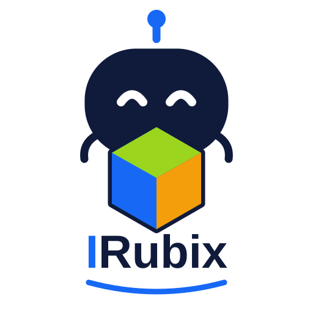

<p align="center">
  
</p>

# IRubix

**کتابخانه سریع و مستقل پایتون برای ساخت ربات روبیکا**

- بدون وابستگی خارجی؛ فقط کتابخانه‌های استاندارد Python
- پشتیبانی از async/await
- دریافت پیام با polling و مدیریت رویدادها با decorator
- ارسال پیام، نظرسنجی، فایل و امکانات مدیریتی
- قابل استفاده در Pydroid 3 و محیط‌های معمول پایتون

**سازنده:** [mahdishami](https://github.com/mahdishami)

**کانال:** https://Rubika.ir/Liberyirubix

## نصب

در Pydroid 3 (بدون نیاز به Git):

```bash
pip install --upgrade https://github.com/adminVIPZEXNET/irubix/archive/refs/heads/main.zip
```

در محیطی که Git نصب است:

```bash
pip install --upgrade git+https://github.com/adminVIPZEXNET/irubix.git
```

## شروع سریع

```python
from irubix import IRubix

bot = IRubix("YOUR_BOT_TOKEN")

@bot.command("start")
async def start(bot, event):
    await event.reply("سلام! به ربات من خوش آمدید.")

@bot.message()
async def echo(bot, event):
    if event.text:
        await event.reply(event.text)

bot.run()
```

## ارسال پیام

```python
import asyncio
from irubix import IRubix

bot = IRubix("YOUR_BOT_TOKEN")

async def main():
    await bot.send_text("CHAT_ID", "سلام از IRubix!")

asyncio.run(main())
```

## امکانات اصلی

| متد | کاربرد |
| --- | --- |
| `get_me()` | دریافت اطلاعات ربات |
| `get_chat(chat_id)` | دریافت اطلاعات چت |
| `send_text(chat_id, text)` | ارسال پیام متنی |
| `send_poll(chat_id, question, options)` | ارسال نظرسنجی |
| `send_file(chat_id, path)` | آپلود و ارسال فایل |
| `forward_message(...)` | فوروارد پیام |
| `edit_message_text(...)` | ویرایش متن پیام |
| `delete_message(...)` | حذف پیام |
| `ban_chat_member(...)` | مسدودسازی کاربر |
| `unban_chat_member(...)` | رفع مسدودسازی |

برای دسترسی به هر متد رسمی دیگری که هنوز wrapper اختصاصی ندارد، از `await bot.request("API_METHOD", {...})` استفاده کنید.

## نکات

- تمام درخواست‌های شبکه‌ای async هستند؛ داخل handlerها از `await` استفاده کنید.
- بازه پیش‌فرض بررسی پیام‌ها یک ثانیه است. می‌توانید با `bot.run(poll_interval=0.5)` آن را تغییر دهید.
- برای جلوگیری از فشار غیرضروری به API، مقدار کمتر از ۰٫۱ ثانیه مجاز نیست.
- حالت Quiz در مستندات فعلی Bot API روبیکا تعریف نشده؛ بنابراین `send_quiz` عمداً خطای `NotImplementedError` می‌دهد.
- توکن ربات را در کد عمومی یا مخزن GitHub قرار ندهید.

## وابستگی‌ها

IRubix در زمان اجرا هیچ پکیج جانبی نیاز ندارد. `setuptools` فقط برای فرایند نصب بسته استفاده می‌شود.

## منابع

- مستندات رسمی: https://rubika.ir/botapi/methods
- مخزن مرجع بررسی الگوها: https://github.com/MEH2RAB/maxrubika

IRubix به‌صورت مستقل پیاده‌سازی شده و کد یا وابستگی اجرایی MAXRubika را وارد نمی‌کند.
